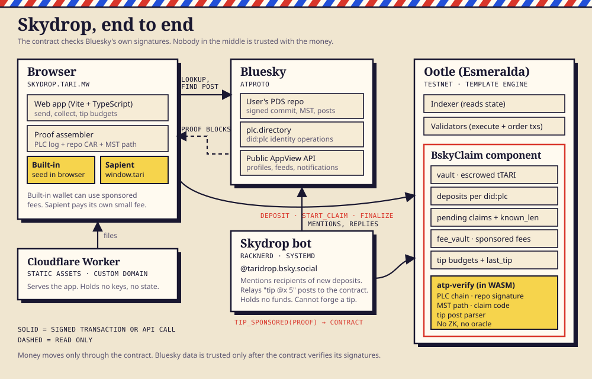

# Skydrop: send Tari to a Bluesky account

Send tTARI (Tari Ootle testnet) to any Bluesky account. The owner collects it by proving, on-chain, that they control the account. No wallet is needed to claim, and nobody has to be trusted.

Live on Esmeralda at https://skydrop.tari.mw



## Docs

- [Architecture](docs/ARCHITECTURE.md): the pieces, data model, claim and tip flows, trust model.
- [Integration guide](docs/INTEGRATION.md): deep links, the TypeScript modules, the contract reference, relayers, running your own instance.

## How the proof works

The escrow is keyed by `did:plc`, not by handle, because handles can be recycled. To claim, the owner posts a message containing `tari-claim:<hex>`. The code is `sha256("tari-bsky-claim:v1:" || component || ":" || did || ":" || claimant key)[..16]`, so it is bound to this escrow and to the claimant's key.

The claim transaction carries:

1. The PLC operation chain. The genesis hash must equal the DID, and each op is signed by a prior rotation key.
2. The signed repo commit, signed by the `#atproto` key (secp256k1 or P-256).
3. The Merkle search tree path to the post.
4. The post record itself.

The template verifies all of it inside WASM (`atp-verify/`). No ZK proof or oracle is involved. A secp256k1 check costs about 2.7% of the transaction budget.

**Challenge window.** A PLC log can't be proven complete, so each deposit has a sender-chosen window (0 to the component maximum, in epochs). During it, anyone can submit a conflicting valid chain to cancel the claim. A window of 0 means instant payout and is meant for small amounts.

**Sponsored fees.** A fee vault inside the component pays network fees only after the proof verifies. Claimants therefore need no account and no funds, and the payout creates their account. Caps are 3 sponsored starts and 3 sponsored payouts per DID. Accounts with long PLC histories may exceed the sponsored compute allowance and pay their own fee instead.

## Layout

| Path | What |
|---|---|
| `atp-verify/` | `no_std` Rust verifier: DAG-CBOR, PLC chain, MST, signatures |
| `bskyclaim/` | The Ootle template (escrow component) |
| `bskyclaim.rs` | Engine tests (synthetic atproto account), 15 tests |
| `cli/bsky_cli.rs` | Esmeralda CLI: publish, new, deposit, fundfees, claim, finalize |
| `src/` | Node proof assembler (PLC log plus repo CAR) |
| `web/` | Skydrop frontend (Vite and TypeScript) |
| `bot/` | Bluesky bot: notifies recipients and relays tip posts |
| `docs/` | Architecture and integration docs |

Rust crates build in a Linux or WSL workspace against tari-ootle. `sync.sh` copies them there.

## Run the web app

```
cd web
npm install
npm run dev     # http://localhost:5190
npm run build   # static output in web/dist
```

The app needs the patched `@tari-project/ootle` and `ootle-wasm` packages in `web/vendor/`. Stock 0.42 packages produce "Invalid transaction signature". Deployment values (component, template) are in `web/src/config.ts`.

## Run the bot

```
cd bot
cp .env.example .env   # fill in BSKY_HANDLE and BSKY_APP_PASSWORD
npx tsx index.ts       # dry-run: prints what it would post
```

Set `CLAIM_URL` and `BOT_LIVE=1` to post for real. The bot holds no funds and no Ootle keys. It rate-limits itself and mentions each recipient at most once per cooldown.

## Status

Testnet only (Esmeralda). Not audited. The challenge window is a stated tradeoff, not a proof of log completeness. Do not use it with real value.
