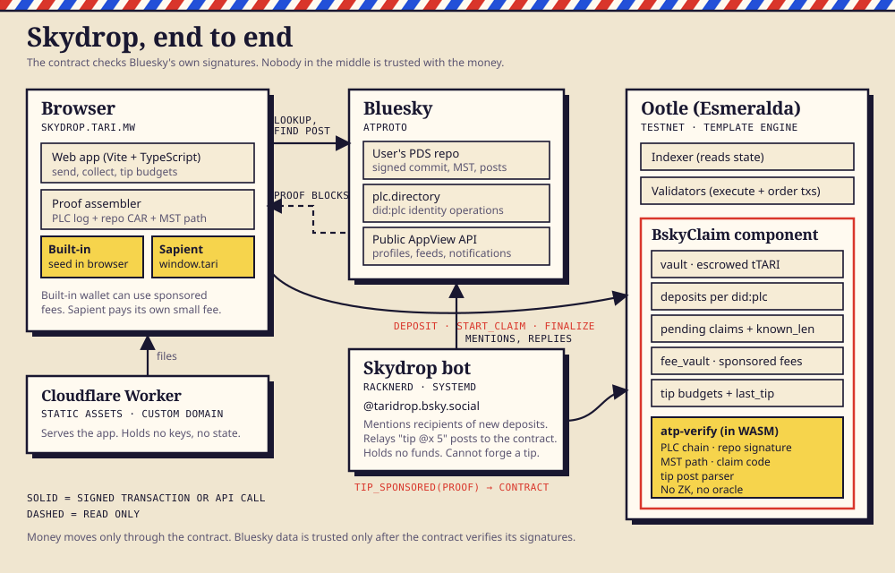
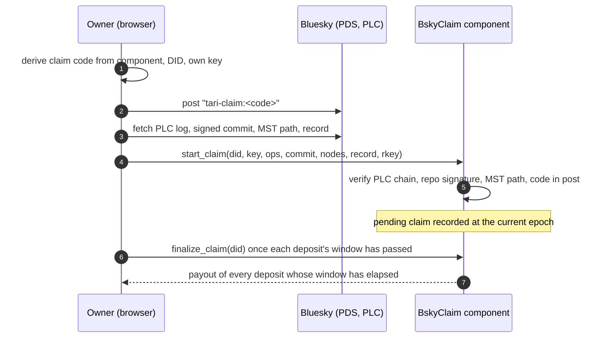
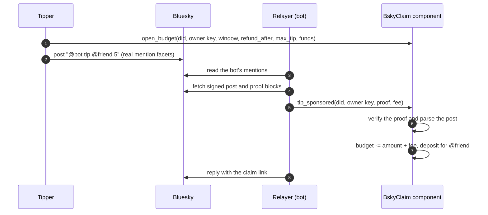

# Architecture

Skydrop lets anyone send Tari to a Bluesky account. The recipient collects by proving, inside the contract, that they control the account. This page explains how the pieces fit together and why nobody in the middle can take the money.

## The idea in one paragraph

Funds are escrowed in an Ootle component keyed by the recipient's `did:plc` (a permanent identifier, unlike a handle, which can be recycled). To collect, the recipient posts a line containing a claim code that binds the escrow, the DID and their wallet key. The claim transaction carries the account's identity history, the signed repository commit and the Merkle path to that post. The contract checks every signature itself, in WASM. There is no oracle, no relayer with authority and no zero-knowledge proof.

## Pieces

| Piece | Where | Role |
|---|---|---|
| `atp-verify` | `atp-verify/` | `no_std` Rust verifier: DAG-CBOR, PLC chain, MST, ECDSA, tip-post parser |
| `bskyclaim` template | `bskyclaim/` | The escrow component. Holds funds and enforces every rule |
| Web app | `web/` | Send, collect, tip budgets. Builds proofs in the browser |
| Proof assembler | `web/src/bsky.ts`, `src/atproto.ts` | Fetches the PLC log and repo CAR, trims them to the blocks the contract needs |
| Wallet layer | `web/src/wallet.ts` | One interface over the built-in wallet and Sapient (`window.tari`) |
| Bot | `bot/` | Mentions recipients and relays tip posts. Holds no funds |
| CLI | `cli/bsky_cli.rs` | Publish, create, deposit, claim and challenge from a terminal |
| Hosting | Cloudflare Worker, RackNerd | Static site and the bot's systemd service |

## Data model

The component state is a CBOR array. Indexes are append-only across versions, so older readers keep working.

| Index | Field | Shape |
|---|---|---|
| 0 | `vault` | Vault of the escrowed resource |
| 1 | `min_deposit` | µT |
| 2 | `max_window_epochs` | Largest challenge window a deposit may choose |
| 3 | `deposits` | `did -> [(sender key, amount, refund_epoch, window)]`, at most 32 per DID |
| 4 | `pending` | `did -> (claimant key, chain tip hash, chain length, start epoch)` |
| 5 | `known_len` | `did -> longest PLC chain seen`. Later claims must match or exceed it |
| 6 | `fee_vault` | Vault of TARI that pays sponsored fees |
| 7 | `sponsored` | `did -> (sponsored starts, sponsored payouts)`, capped at 3 each |
| 8 | `budgets` | `"did:ownerKeyHex" -> (balance, window, refund_after, max_tip)` |
| 9 | `last_tip` | `did -> last spent tip rkey` |
| 10 | `bot_did` | The account that tip posts must mention |

## Flows

### Send

The sender signs one transaction: withdraw from their account, call `deposit(did, sender_key, refund_epoch, window, funds)`. The sender chooses the challenge window per deposit. They can refund themselves after `refund_epoch`.

### Claim

Each deposit pays out only when `current_epoch >= claim start + that deposit's window`. A window of 0 pays immediately. Deposits still inside their window stay escrowed and the claim stays pending. Only the claimant key can call `finalize_claim`. Starting a new valid claim replaces the pending one and restarts its windows, which is only possible for whoever can post from the account.

### Challenge

A PLC log cannot be proven complete: someone could present an older, valid chain from before a key rotation. The challenge window closes that gap. During it, anyone may call `challenge(did, ops)` with a different valid chain and cancel the claim. `known_len` also forces every later claim to present a chain at least as long as the longest one ever shown.

### Tip by post

The post's signature is the authority. A relayer cannot forge, alter or replay a tip: the amount and recipient come from the signed record, the rkey must be a 13-character TID strictly greater than `last_tip[did]`, and the tip is capped by the budget's `max_tip`. Whoever controls the Bluesky account can spend the budget, which is why the cap exists. Only the key that funded the budget can withdraw it.

## What the contract verifies

1. **Identity chain.** The first operation's hash equals the DID. Every operation is signed by a rotation key from the one before. The last operation names the `#atproto` repo signing key.
2. **Repo commit.** The signed commit verifies under that signing key (secp256k1 or P-256).
3. **Path to the post.** The Merkle search tree path hashes up to the commit's `data` root, and the leaf is the post's record.
4. **The post.** Its text contains the claim code, which is `sha256("tari-bsky-claim:v1:" ‖ component ‖ ":" ‖ did ‖ ":" ‖ claimant key)[..16]`. The claimant must also sign the transaction.

Measured cost: a secp256k1 verification is about 2.7% of the 250M-point transaction budget, P-256 about 14%. A one-operation claim is about 14M points and a tip about 14M.

## Fees

A **fee vault** inside the component pays network fees, but only after a proof verifies, so an invalid claim costs the vault nothing. This lets someone with no account claim: the fee-phase call is signed by the claimant key and the payout creates their account. Caps are three sponsored starts and three sponsored payouts per DID, at most 100,000 µT per call. Accounts with very long PLC chains can exceed the fee-phase compute allowance and fall back to paying their own fee. Wallets that can't expose the signing key (Sapient) always self-pay.

## Trust model

| Party | Can | Cannot |
|---|---|---|
| Sender | Choose the window, refund after `refund_epoch` | Take funds back early |
| Recipient | Claim with a valid proof | Claim without controlling the DID's signing key |
| Anyone | Challenge a claim during its window, relay a tip, fund the fee vault | Move escrowed funds |
| Relayer / bot | Submit a signed tip post | Forge, alter or replay a tip, or touch a budget |
| Indexer | Return state to the app | Change state. Transactions are signed locally |
| Bluesky, plc.directory | Serve data | Make the contract accept a forged signature |
| Cloudflare | Serve the static app | Sign anything. The seed never leaves the browser |

Residual risks, stated plainly:
- The challenge window is a tradeoff, not a proof of log completeness. A thief with a stolen signing key that the owner already rotated away can win only if nobody submits the rotation in time. Use a window for large amounts.
- A stolen Bluesky key can spend that account's tip budget up to `max_tip` per post. Keep budgets small.
- Testnet only. Not audited.

## Deployment

| Thing | Value |
|---|---|
| Network | Ootle Esmeralda testnet |
| Site | `https://skydrop.tari.mw`, a Cloudflare Worker serving static assets (`web/wrangler.jsonc`) |
| Bot | RackNerd VPS, systemd unit `skydrop-bot` (`bot/skydrop-bot.service`), runs as the `skydrop` user |
| Contract | Template and component addresses live in `web/src/config.ts` |

Superseded components still hold their old deposits. Senders can refund them after the refund epoch. The app only reads the current component.

## Not built yet

`did:web` accounts, private payouts to a stealth address, monitoring of the sponsor vault level, and support for older component versions in the UI.
